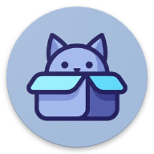

<div align="center">
  
  <h1>Re:NekoBox</h1>
  <p><strong>A modern Material 3 Expressive proxy toolchain for Android, powered by dual-channel sing-box.</strong></p>

  <p>
    <a href="https://github.com/HatsuneMikuUwU/Re-NekoBox/releases">
      
    </a>
    <a href="https://github.com/HatsuneMikuUwU/Re-NekoBox/releases">
      
    </a>
    
    
    <a href="LICENSE">
      
    </a>
  </p>

  <p>
    <a href="https://github.com/HatsuneMikuUwU/Re-NekoBox/releases">Downloads</a>
    ·
    <a href="https://t.me/uwuowoumuchannel">Telegram Channel</a>
    ·
    <a href="https://t.me/+MEVNxO_1OjM0Mjll">Telegram Group</a>
    ·
    <a href="https://github.com/HatsuneMikuUwU/Re-NekoBox/issues">Issues</a>
  </p>
</div>

---

## Highlights

| Area | What's Included |
| :--- | :--- |
| **Material 3 Expressive UI** | Full Jetpack Compose interface with MaterialKolor dynamic theming (`SPEC_2025` / `2026`), custom seed & per-role color overrides, AMOLED dark mode, UI & font scaling, onboarding flow, SplashScreen, and app-wide haptics. |
| **Visual Effects & Chrome** | 11 animated backgrounds + seasonal themes with accelerometer parallax, Blur & Liquid Glass bars, and a switchable **Floating Tab Bar** or blurred **Material 3 NavigationBar**. |
| **Dual-Channel Kernel Manager** | Ships with both **sing-box 1.14.0 (Stable)** and **1.15.0-alpha.14 (Preview)** built in—switch channels offline, check signed GitHub Release kernel updates, and recover automatically on boot failure. |
| **sing-box 1.14 / 1.15 Core Options** | Optimistic DNS cache, DNS cache capacity & query timeout, AAAA / SVCB & HTTPS query blocking, Android system Hosts, Bootstrap DNS IP, TUN DNS mode, UDP session timeout, native TLS handshake fragmentation (`record` / `packet`), default uTLS fingerprint, persistent `cache_file`, and preview TLS certificate SHA-256 pinning. |
| **Subscriptions & Management** | Long-press drag-and-drop reordering for profiles, groups, and routes; Subscription **Device ID** (HWID Support, Spoof App for Happ / v2RayTun / Incy, Device Profile presets, editable headers); and built-in **MetaCubeXD** Clash API dashboard. |

---

## Downloads

Get the latest builds directly from **[GitHub Releases](https://github.com/HatsuneMikuUwU/Re-NekoBox/releases)**.

> [!WARNING]
> **Re:NekoBox is distributed exclusively through GitHub Releases and our official Telegram channels.** Do not install third-party or unofficial Google Play reuploads.

---

## Supported Protocols

| Category | Protocols |
| :--- | :--- |
| **Standard & Tunnel** | SOCKS (4 / 4a / 5), HTTP(S), SSH, WireGuard |
| **Modern Proxy** | VLESS, VMess, Trojan, Shadowsocks, ShadowsocksR, AnyTLS / AnyReality, ShadowTLS |
| **QUIC & High-Throughput** | Hysteria 1 / 2, TUIC, Juicity, Snell (1–6) |
| **Plugin-Extended** | Trojan-Go, NaïveProxy, Mieru |

### Supported Subscription Formats

- **Common formats**: Shadowsocks, Clash / ClashMeta, v2rayN, and raw URI lists
- **sing-box outbound configs**: Parses outbound nodes directly (diversion/routing blocks in external subscriptions are ignored)

<details>
<summary>XHTTP Extra Configuration Examples (TLS &amp; Reality)</summary>

#### TLS Example

```json
{
  "no_grpc_header": false,
  "x_padding_bytes": "100-10000",
  "xmux": {
    "max_concurrency": "16-32",
    "max_connections": "0-0",
    "c_max_reuse_times": "0-0",
    "h_max_request_times": "600-900",
    "h_max_reusable_secs": "1800-3000",
    "h_keep_alive_period": 0
  },
  "download": {
    "mode": "auto",
    "host": "b.yourdomain.com",
    "path": "/xhttp",
    "server": "$(ip_or_domain_of_your_cdn)",
    "server_port": 443,
    "tls": {
      "enabled": true,
      "server_name": "b.yourdomain.com",
      "alpn": "h2",
      "utls": {
        "enabled": true,
        "fingerprint": "chrome"
      }
    }
  }
}
```

#### Reality Example

```json
{
  "no_grpc_header": false,
  "x_padding_bytes": "100-10000",
  "download": {
    "mode": "auto",
    "host": "example.com",
    "path": "/xhttp",
    "server": "$(ip_or_domain_of_your_cdn)",
    "server_port": 443,
    "tls": {
      "enabled": true,
      "server_name": "example.com",
      "reality": {
        "enabled": true,
        "public_key": "$(your_publicKey)",
        "short_id": "$(your_shortId)"
      },
      "utls": {
        "enabled": true,
        "fingerprint": "chrome"
      }
    }
  }
}
```

</details>

---

## Building from Source

### Prerequisites

- **JDK 17**
- **Go 1.26.11+**
- **Android SDK** (`compileSdk 37`, `targetSdk 37`, `minSdk 24`) & **NDK `25.0.8775105`**
- **Python 3** (for dual-core packaging & loader verification)

### Build Steps

```bash
# 1. Clone repository with submodules
git clone --recursive https://github.com/HatsuneMikuUwU/Re-NekoBox.git
cd Re-NekoBox

# 2. Build stable and preview libcore AARs
CORE_CHANNEL=stable buildScript/lib/core/init.sh
CORE_CHANNEL=stable buildScript/lib/core/build.sh
cp libcore/libcore.aar core-stable.aar

CORE_CHANNEL=preview buildScript/lib/core/init.sh
CORE_CHANNEL=preview buildScript/lib/core/build.sh
cp libcore/libcore.aar core-preview.aar

# 3. Package dual cores into app/libs & jniLibs
python3 .github/scripts/package_cores.py \
  --stable core-stable.aar \
  --preview core-preview.aar

# 4. Download GeoIP/GeoSite assets & build OSS release APK
bash buildScript/lib/assets.sh
./gradlew app:assembleOssRelease
```

---

## Community

- **Telegram Channel**: [t.me/uwuowoumuchannel](https://t.me/uwuowoumuchannel)
- **Telegram Group**: [Join Community Group](https://t.me/+MEVNxO_1OjM0Mjll)

---

## Disclaimer

> This project is intended solely for technical research and code learning purposes and does not provide any form of network proxy service. Do not use this project for any activities that violate local laws and regulations. Users are solely responsible for all risks arising from using this software.

---

## Credits & License

- **Core**: [SagerNet/sing-box](https://github.com/SagerNet/sing-box)
- **Upstream Android Client**: [MatsuriDayo/NekoBoxForAndroid](https://github.com/MatsuriDayo/NekoBoxForAndroid), [SagerNet/SagerNet](https://github.com/SagerNet/SagerNet), [shadowsocks/shadowsocks-android](https://github.com/shadowsocks/shadowsocks-android)
- **Web Dashboard**: [MetaCubeX/metacubexd](https://github.com/MetaCubeX/metacubexd)
- **UI & Feature Inspiration**: [AnimeX](https://github.com/HatsuneMikuUwU/AnimeX-App), ArcaenBox, NekoBoxPlus

Licensed under the **GNU General Public License v3.0 (GPL-3.0)** — see [LICENSE](LICENSE) for details.
